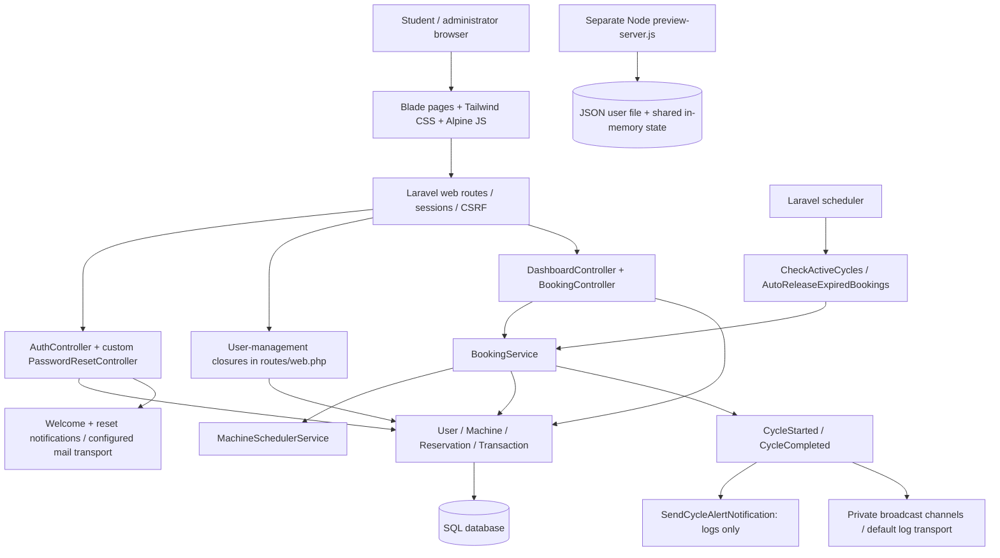

# Original repository architecture, authentication and browser audit

Reviewed 11 October 2026, Africa/Casablanca. Repository: `yahya-dev-e/ecc_laundry2.0`. Source baseline: `0d68592d6c364044d3bd56cded1eadc01752a7e6`.

Work branch: `codex/architecture-auth-mobile-audit-2026-10-11`. This is an audit of the original repository's current source, separate from the earlier fork review. No production fixes, deployment, production account changes or changes to main are included.

## Result

The application is not ready for an unrestricted school rollout. The most urgent verified problem is a missing authorization boundary: **an authenticated student can promote their account to administrator or change another user's identity fields**. A second verified security issue lets an untrusted HTTP Host become the password-reset link's host.

Normal mobile signup, login, hourly booking, reservation details and cancellation worked in Chromium, Firefox, Edge and WebKit. That does not cancel out the security and edge-case failures below. The admin add-user and edit-user flows fail consistently. Registration validation errors are hidden, and the registration page has visibly broken styling.

## Architecture actually present

This is a Laravel monolith with a separate imitation Node server, not one shared backend. Laravel owns the real password/session/database rules. Node independently renders screens, mutates its own users and reservations, and simulates authentication and email. Passing a preview test is not evidence that the Laravel flow works. No physical machine-control integration is implemented in the reviewed start/completion path; it updates database state and emits events.

## Evidence and limits

* `evidence/php-probes.txt`: **19 probes, 69 assertions**, all reproduced the stated observations. Several probes deliberately assert a defect; their green result means the defect exists, not that the application is safe.
* `evidence/original-tests.txt`: the original suite produces **12 errors, zero assertions**, due to the missing `Database\Factories\UserFactory`.
* `evidence/browser-results.json`, `evidence/browser-extra-results.json` and `evidence/browser-webkit-results.json`: browser/page observations, including validation failures and layout measurements. The first file also retains initial Firefox/WebKit installation errors; the later files contain successful runs. `ok: true` means the inspection/action ran; read the recorded behavior fields to determine whether the product behaved correctly.
* `evidence/workflow-results.json` and `evidence/workflow-webkit-results.json`: real HTTP signup, login, mobile booking, details, cancellation and admin-button checks across Chromium, Firefox, Edge and WebKit.
* `evidence/landscape-results.json`: the login submit button extends beyond the viewport and wheel scrolling does not move the page in 844×390 touch emulation.
* `evidence/smtp-results.json`: both real notification templates rendered and were accepted by a localhost SMTP capture, with the expected dashboard/reset links. Only synthetic `example.test` recipients were used. This does **not** verify production SMTP credentials, DNS/SPF/DKIM/DMARC, spam filtering, delivery to Gmail/Outlook/school inboxes, or production HTTPS links.

The checkout is missing `public/index.php` and the base `App\Http\Controllers\Controller`. Browser testing therefore used an explicitly separate audit router and a base-controller alias. The audit also generated writable framework directories, used an isolated SQLite database, file sessions, array cache and synchronous queues. **These are test scaffolding, not fixes or evidence that a pristine deployment works.** No production database or deployed URL was supplied or tested.

PHP runtime: 8.3.33. Installed Laravel: 11.57.0. PHPUnit: 11.5.56. A clean Composer dependency resolution was blocked by Composer's security-advisory policy for the declared Laravel constraint. After attempts to install into the isolated copy encountered runtime access/download problems, existing PHP libraries were copied into that copy and their application autoload mappings regenerated. Generated dependency locks are not part of this audit change. The exact production dependency set remains unknown.

## Prioritized findings

### 1. Critical: students can administer users

**Verified by HTTP/controller probe.** `routes/web.php:38`, `:57`, `:62`, `:73` protect user management with `auth` only. A student can read `/utilisateurs` and POST their own ID plus `role=admin` to `/admin/users/update`; the database role changes to admin. The same endpoint accepts another user's name, email, student ID and room. Changing a victim's email also creates an account-takeover route through password reset. Hiding the navigation link is not authorization.

Fix first: an admin middleware/policy on every user-management action; validate IDs and uniqueness; test student denial for both reads and writes. Do not rely on the broken edit form to prevent crafted requests.

### 2. High: password-reset links trust the request Host

**Verified.** `app/Notifications/ResetPasswordNotification.php:41` constructs a relative route and passes it to `url()`. Posting a reset request with `Host: evil.example.test` produces a notification action URL on that host. The test captured the notification and inspected its link; no external site was contacted. Whether a production reverse proxy already blocks bad hosts is unknown.

Generate links from an explicit trusted canonical origin and reject unexpected hosts at the app/proxy boundary.

### 3. High: booking creation is not safe against concurrent requests

**Source-confirmed; no production load test.** `app/Services/BookingService.php:35` checks overlap and quota before the transaction at `:55`. `MachineSchedulerService::isMachineAvailableForSlot()` is a normal existence query. No machine/user row lock or database exclusion constraint serializes competing bookings. Two requests can both see an available slot or sufficient quota and then insert.

Lock the resource and quota owner inside one transaction, recheck under the lock, and enforce the invariant at the database layer where supported. Test using separate database connections against the deployment database engine.

### 4. High: the transaction ledger points at the wrong table

**Verified.** `database/migrations/2026_01_01_000003_create_transactions_table.php:17` infers a foreign key to `bookings`, but bookings live in `reservations`. SQLite migration creation succeeds; ledger inserts and `db:seed` fail on the absent parent table. `User.php:147` catches and discards booking-charge insert failures, so a successful reservation has no charge record. MySQL migration behavior still needs an actual MySQL run; the invalid referenced table is present in the source regardless.

Point the FK explicitly at `reservations`, repair historical ledger discrepancies, and stop treating failed accounting writes as optional.

### 5. High: final weekly credit cannot be used

**Verified.** `BookingService.php:56` inserts the reservation before `deductCredits()` at `:66`. `User.php:131` checks availability again using the updated reservation count. Seven hourly reservations succeed for an eight-credit student; the eighth sees zero remaining after its own insertion and throws, rolling back. The UI still advertises one available credit.

Validate/debit a single quota representation once within the booking transaction.

### 6. High: a multi-slot failure leaves earlier slots booked

**Verified.** `BookingController::store()` commits each selected slot separately. A request containing the same future start twice books the first, fails on the second, and returns an error even though the first booking persists. Conflict/quota failures later in a legitimate selection have the same partial-result risk. There is no `distinct` rule on the input array.

Choose explicit all-or-nothing semantics or report partial success accurately. Validate distinct slots and transact the complete selection.

### 7. High: machine state is not tied to an active cycle

**Verified.** `Reservation::canBeStarted()` accepts any upcoming reservation. `BookingService.php:80` does not enforce a start window or recheck machine operability. A reservation two days away can start a machine that was subsequently put in maintenance. At `:145`, cancellation sets a reserved/in-use machine to available even when cancelling a different future reservation. The probe reproduced both state changes.

Represent the active reservation/cycle explicitly, require ownership plus an allowed start window and current machine state, and only release the cycle associated with the cancelled/finished booking.

### 8. High: fresh-checkout deployment is incomplete

**Source-confirmed plus local test evidence.** Missing files include `public/index.php`, `app/Http/Controllers/Controller.php` and the `.docker/8.3` build context named in `compose.yaml:5`. The example selects database cache and queues, but there are no cache/jobs-table migrations. The original tests cannot run because UserFactory is missing. There is no committed Composer lock. The provided `migrate --seed` path also fails on the ledger FK above. Docker itself was unavailable locally, so no container deployment was claimed.

Restore the application skeleton, pin dependencies, reconcile migrations/seeding and verify a clean install in CI rather than relying on a previously populated development folder.

### 9. High: authentication and reset endpoints have no throttling

**Verified for login; source-confirmed for reset/signup.** Twenty consecutive wrong-password POSTs returned normal 302 failures without a 429 or application lockout. The guest routes have no throttle middleware and the controllers have no limiter. Reset requests also synchronously hash/store a new token and send mail each time.

Apply per-account and per-IP limits, with a generic response that does not expose whether the account exists.

### 10. High: reset does not revoke remember-me credentials

**Verified for the stored token; active-session revocation is absent in source.** `PasswordResetController.php:109` changes only `password`; `remember_token` remains identical. There is no session-revocation step or password-reset event, and token validation/password update/token deletion are separate operations without a transaction or row lock.

Use Laravel's reset broker or implement equivalent atomic consumption, remember-token rotation, session revocation policy and reset events. Re-test an already-authenticated browser and a previously issued remember cookie.

### 11. Medium: mail failure breaks reset and misreports welcome delivery

**Verified using a refused localhost SMTP connection.** Resetting an existing account returns 500 because `PasswordResetController.php:55` does not catch delivery failure; an unknown email still gets a normal generic response. This also exposes account existence during a mail outage. Registration catches welcome-mail failure but still says an email was sent. A reset token is replaced before delivery succeeds, invalidating older links even if the replacement mail fails.

Queue/retry mail reliably, use truthful delivery status, preserve generic public responses, and define safe token replacement behavior.

### 12. Medium: admin add/edit buttons fail

**Verified in Chromium, Firefox, Edge and WebKit at phone width.** The add-user link points at guest-only `/register`, so a logged-in admin is redirected to `/dashboard`. The edit modal sends `_token,id,name,email,role,weeklyLimit,weeklyUsed`, while the endpoint also requires `student_id` and `room_number`. Save redirects with validation errors that the page never displays. A duplicate email submitted with otherwise valid fields returns 500 because the endpoint lacks uniqueness validation.

Create a real admin user-creation flow, align request fields with the form, and show field-level errors.

### 13. Medium: quota controls and labels disagree with quota enforcement

**Verified reset behavior; remainder source-confirmed.** `User.php:98` uses global role-based limits and `:103` counts reservations, not hours. `getCreditsAttribute()` ignores stored credits. Admin weekly-limit/reset actions only change stored credits, so they do not change the displayed/enforced remaining quota. The edit form's `weeklyUsed` is ignored. The API accepts 20–120 minute bookings, but counting rows cannot consistently implement an hours quota. Registration advertises ten credits, writes a non-fillable credits attribute, and the new account actually has the migration default eight.

Pick one policy and one persisted representation; derive UI labels, costs, refunds, individual overrides and reset behavior from it. Admin UI also calls a finite 100-hour limit “unlimited.”

### 14. Medium: registration feedback and styling are broken

**Verified visually and by browser submission.** `resources/views/auth/register.blade.php` extends the authenticated layout, uses undefined `glass-card`, `glass-input` and `btn-primary` classes, and renders white/pale text on a pale background. Password-confirmation errors are not displayed. It lacks autocomplete hints. Guest navigation defaults to an administrator and “R. Omari” (`layouts/navigation.blade.php:2`), showing irrelevant admin/logout UI to guests. This is a UI identity bug, not proof of guest authorization.

Use an authentication layout, existing styled form components and visible field errors. Normalize email casing deliberately rather than silently rejecting capitalized input.

### 15. Medium: short landscape login needs a scrolling fix

**Verified layout/scroll problem; native keyboard behavior untested.** At 844×390 the login card extends below the viewport and the submit button is clipped. In touch emulation, the measured submit bottom was 469.75px against a 437px layout viewport, and wheel scrolling left `scrollY=0`. `.login-bg` sets `overflow:hidden` and a minimum-height centered card. Desktop auth pages also have decorative horizontal overflow. Inputs become 16px only below 640px; at 844px they are 12px, leaving an iOS landscape focus-zoom risk. Native iOS zoom/keyboard behavior still needs a physical-device check.

Allow vertical scrolling on auth pages, constrain decorative elements separately, and retain readable input sizes for touch devices in landscape and with the keyboard open.

### 16. Medium: selecting a slot requires pointer interaction

**Verified.** The available-slot controls in `bookings/create.blade.php:145` are clickable labels with no associated input, button role or keyboard focus. The actual booked slot has `tabIndex=-1`. Calendar blocks are clickable divs. Calendar/edit modals have no dialog semantics or focus trap; the workflow inspection found zero `role=dialog` elements. Some close/search buttons and edit labels lack accessible names/associations.

Use native buttons/checkboxes, expose selection state, and implement dialog focus entry, trapping, Escape and focus return. Native screen-reader and switch-control testing remains outstanding.

### 17. Medium: slot display can offer a slot the server rejects

**Source-confirmed.** The booking page filters today's slots only by browser hour, while the service rejects starts more than 15 minutes in the past. At 14:45, the UI still offers 14:00; the service rejects it. The browser's timezone also drives parts of availability and the calendar pointer, whereas the example app timezone is UTC. The shared server clock does not make all slot decisions server-based.

Use one explicit campus timezone and the same server-derived availability cutoff for display and validation. Test midnight, Sunday/Monday, Morocco offset changes and a client in a different timezone.

### 18. Medium: no-show release, completion and alerts are incomplete

**Source-confirmed.** Advance reservations are not promoted to reserved state when their start approaches; `releaseExpiredBookings()` only considers machines already reserved and reservations not yet ended. Missed reservations can therefore evade release. `CheckActiveCycles` calls completion after no active reservation remains, while completion searches for a still-active reservation, often losing the recipient. `SendCycleAlertNotification` only logs; it does not email/SMS/push. The default database queue requires missing jobs tables and a worker; the compose file supplies neither a scheduler nor a worker service.

Define a durable cycle state machine, schedule/queue deployment requirements and real notification delivery. Persist cancelled/no-show history rather than deleting the audit trail.

### 19. Medium: cancellation success and redirects are misleading

**External redirect verified; zero-cancellation message source-confirmed.** `BookingController::cancel()` accepts arbitrary `redirect_to` values. Batch cancellation catches exceptions and reports singular success even when zero reservations were cancelled. Refund/cancellation history is not durable and the reason is unused.

Restrict destinations to internal routes, return actual per-item outcomes, and make cancellation/refund idempotent and auditable.

### 20. Medium: demo credentials and unsafe environment defaults

**Source-confirmed and visible in the browser.** The login form prefills `admin@fecc.ma` and a password, while the seeder creates `admin@ecc.edu`; the default pair does not match the seed account. The seeder/README contain public demo credentials, and the example includes a fixed app key, debug enabled, UTC and log-mail defaults. These must not become production settings. No claim is made that a deployed site currently accepts the demo passwords.

Remove credential prefills, gate demo seeding to development, generate per-environment keys and verify production HTTPS, secure cookies, debug-off and correct timezone/mail configuration.

### 21. Medium: Node preview must remain an isolated demo

**Source-confirmed; not used to establish Laravel results.** `preview-server.js:164` starts authenticated; `:2396` accepts login without checking credentials; reset uses a demo token and reports success without a real password reset. Authentication and role state are process-global rather than per user. Registration does not implement Laravel's password rules or real email transport. Reservations are in memory; users are persisted to a JSON file. It binds `0.0.0.0` at `:2729`.

Do not expose or deploy this server as the school application. Clearly label it a demo and move functional tests to the real backend.

### 22. Lower priority: scale, dead paths and configuration drift

**Source-confirmed.** Dashboard history and the user directory load whole collections. Both mobile and desktop user lists calculate per-user quota queries; pagination/count aggregation is needed as users/history grow. Machine slots/status controllers and JS exist but corresponding routes are absent. Settings, complaints and machines routes redirect to the dashboard, so those features are not implemented. Several configuration values such as simultaneous-reservation limits are not enforced. The frontend does not subscribe to the declared broadcast events, so a visible client clock is not live reservation synchronization.

Remove dead paths or complete their contracts, paginate history/directories, aggregate quota usage, and make configuration correspond to enforced behavior. Measure with realistic school-sized data before expanding to other facilities.

## What worked

* Actual account creation, subsequent password login, logout, hourly booking, mobile confirmation, reservation-details opening and cancellation in Chromium, Firefox, Edge and WebKit.
* Login regenerates the session; logout invalidates it and regenerates CSRF state, as seen in source. Framework CSRF remains enabled on the browser-tested form routes.
* Password hashing, random hashed reset tokens, normal generic reset-request responses, token expiry and token single-use in the sequential tests.
* Portrait 320px and 390px main pages did not show document-wide horizontal overflow in the measured Chromium layouts. Mobile password toggle, navigation opening/Escape and confirmation controls worked.
* The current normal booking form and machine configuration both use one-hour durations. The older fork's two-hour mismatch is **not** reported as a current finding.

## Compatibility coverage

| Platform/browser | Actual evidence | Status |
|---|---|---|
| Windows, Chrome for Testing / Chromium 151.0.7922.34 | 1440×900, 390×844, 320×568, 844×390; full 390px workflows | Tested locally |
| Windows, Playwright Firefox 153.0 | 1440×900, 390×844; full 390px workflows | Tested locally; patched automation build, not every retail Firefox version |
| Windows, installed Microsoft Edge 155.0.4283.45 | 1440×900, 390×844; full 390px workflows | Tested locally |
| Windows, Playwright WebKit 26.5 download | 1440×900, 390×844, 320×568, 844×390; full 390px workflows | Tested engine approximation; does not establish Safari-on-Apple coverage |
| Opera / Opera Android | No installed Opera run | Not verified; Chromium similarity is not an Opera test |
| Native Android versions / Chrome Android | Chromium touch/viewport emulation only | Not verified on real devices |
| Native iOS versions / Safari | No real iPhone/iPad run | Not verified |
| macOS / Linux | No execution environment run | Not verified |
| Production SMTP and school inbox | Local SMTP capture only | Not verified |
| MySQL deployment, concurrent load, physical machines | SQLite/local backend and source review only | Not verified |

This is not a guarantee for “all possible users.” A release matrix should name supported browser/OS versions and include Android Chrome/Firefox/Opera, iPhone/iPad Safari, desktop Safari/macOS, Linux Chrome/Firefox, older supported devices, keyboard/screen-reader use, slow/offline networks, cookie restrictions, private browsing and password managers. Run those against the fixed Laravel app and the production database/mail configuration, not the Node demo.

## Suggested repair order

1. Close admin authorization and reset-host trust; remove demo exposure and add auth/reset rate limits.
2. Restore a reproducible clean Laravel deployment, resolve dependency advisories, correct the ledger migration, and add reliable CI tests.
3. Make reservation/quota writes atomic; repair last-credit, multi-slot, machine lifecycle and cancellation invariants.
4. Correct admin forms, registration errors/styles, landscape scrolling and keyboard/dialog accessibility.
5. Finish queued email/cycle notifications and deployment workers; then run the named real-device/OS and production-deliverability matrix.

This branch deliberately records findings and reproducible probes only. Production fixes should be separate, reviewable branch changes.
